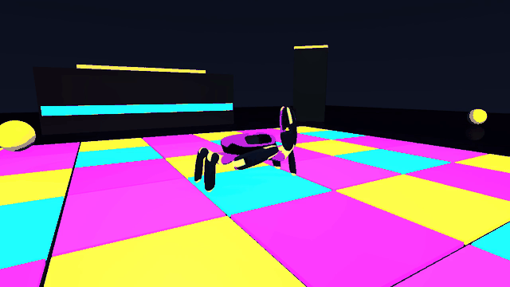
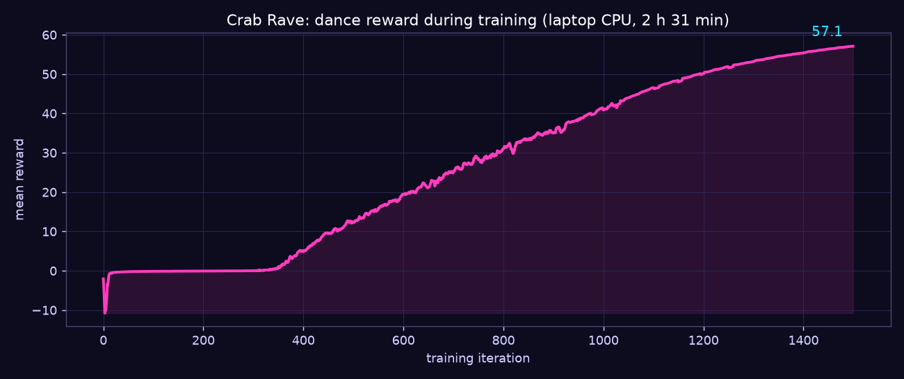

# Crab Rave 🦀🪩 A Jumper robot dance, trained on a laptop CPU

▶ **[Watch the full 40-second dance on YouTube](https://youtu.be/A1up2xPV_xk)** (silent). The MP4 files are in [`1_FINAL_VIDEOS/`](1_FINAL_VIDEOS).

KingKong Tech's open-source **Jumper** crab robot, dancing in a neon "Crab Rave" disco, all in
simulation. I trained the dance on a Ryzen 5 laptop CPU with **no GPU**, built the disco floor,
and gave the robot a black, white and violet striped look. Made for the
[Crab Robot Open-source Challenge](https://beunlimited.me/en/events/crab-robot-challenge-2026).

## Results

| | |
|---|---|
| Task | `jumper.dance`, the demo choreography that ships with the toolkit |
| Training | 256 simulated robots, 1,500 iterations, native CPU backend |
| Time | 2 h 31 min on a Ryzen 5 5500U with 7.3 GB RAM and no GPU |
| Reward | about -2.1 at the start, **57.10** at iteration 1499 |
| Recording | 40 s with no fall: the robot stayed upright the whole time |

The reward stays near zero for roughly the first 330 iterations, then climbs steadily. The data
is in [`4_TRAINING/reward_curve.csv`](4_TRAINING/reward_curve.csv).

**What is mine, and what is not.** The dance itself is the demo choreography from KingKong's
toolkit. The Crab Rave scene, the striped skin, the training run and the filming are my work.

## What is in this repo

| Folder | Contents |
|---|---|
| [`1_FINAL_VIDEOS/`](1_FINAL_VIDEOS) | The dance: `crab_rave_dance.mp4` (1280x720) and `crab_rave_dance_vertical.mp4` (720x1280), the preview GIF, cover images and the script that builds the covers |
| [`2_SCENE/`](2_SCENE) | The Crab Rave scene: `crab_rave.map` (verified scene package), its source `crab_rave.scene.json` and `make_crab_rave.py` that rebuilds the source |
| [`3_SKIN/`](3_SKIN) | The striped robot model `jumper_neon.xml` and `make_neon_skin.py` that rebuilds it from the stock model (colors only; shape and physics unchanged) |
| [`4_TRAINING/`](4_TRAINING) | The trained policy (`model_1499.pt`, plus an ONNX export), the reward curve, exact package versions and [`COMMANDS.md`](4_TRAINING/COMMANDS.md) with every command used |
| [`5_RULES/`](5_RULES) | The contest rules as read on 2026-10-28, a compliance checklist and the sources |
| `RENDER_FINAL.ps1` | Re-renders the final video from the saved policy, skin and scene |

## Rebuild it

The two toolkit repositories are not copied here. Clone them at the commits I used:

- [KingKongRobotics/jumper](https://github.com/KingKongRobotics/jumper) at
  `b2e58669848a3ba4f209597cd6bebdfe9d0533a4` (2026-10-12): training and replay
- [KingKongRobotics/jumper-design](https://github.com/KingKongRobotics/jumper-design) at
  `918d192857fcea1678c2a40b339501004a94d838` (2026-09-30): scene export

Then follow [`4_TRAINING/COMMANDS.md`](4_TRAINING/COMMANDS.md). It covers the Python 3.11
environments (CPU torch, MuJoCo 3.11), training, building and verifying the scene, making the
skin and rendering the video. Exact package versions are in
`4_TRAINING/requirements-*-lock.txt`. Place the clones next to this folder's contents as
`jumper/` and `jumper-design/`, as `RENDER_FINAL.ps1` expects.

## How it was made

1. **Train.** `scripts/train.py --task jumper.dance` with 256 environments on the CPU backend.
2. **Scene.** `make_crab_rave.py` writes the scene spec: a 7x7 neon tile floor, speaker stacks,
   a DJ booth with a glowing strip, a mirror ball and beach balls. `jumper-design` exports and
   verifies it as `crab_rave.map`.
3. **Skin.** `make_neon_skin.py` recolors a copy of the robot model link by link, so the stripes
   alternate along each leg and claw.
4. **Film.** `scripts/play.py` replays the trained policy in the scene with a fixed camera and
   records the MP4.

## Good to know

- **The skin shows only through `--model`.** Replay always uses the task's own robot and the
  toolkit has no `.skin` loader, so the striped look is a recolored copy of the robot model.
- **Maps are replay-only.** `play.py --scene` accepts `crab_rave.map`; `train.py` refuses it.
- **Slow PyPI?** On a slow connection a PyPI mirror helped a lot (see `COMMANDS.md`).
- **Do not replay while training**: it slows both.
- **Music:** the video is silent. The choreography runs at 129.88 BPM with its first beat at
  2.0 s, if you want to match a track. Use music you hold the license for.

## Credits and license

Built on KingKong Tech's open-source
[jumper](https://github.com/KingKongRobotics/jumper) and
[jumper-design](https://github.com/KingKongRobotics/jumper-design), both Apache-2.0. See
[`NOTICE`](NOTICE) for what is derived from them. This repository is licensed under Apache-2.0
([`LICENSE`](LICENSE)). It is an independent project, not affiliated with or endorsed by KingKong
Tech.
